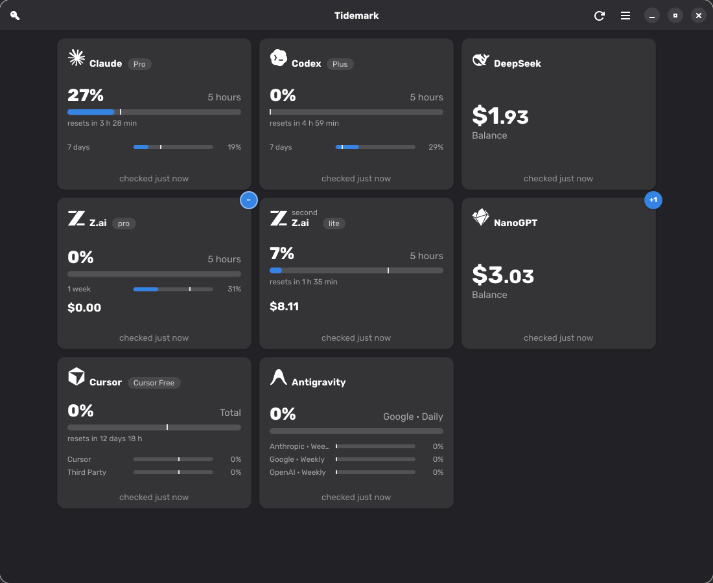
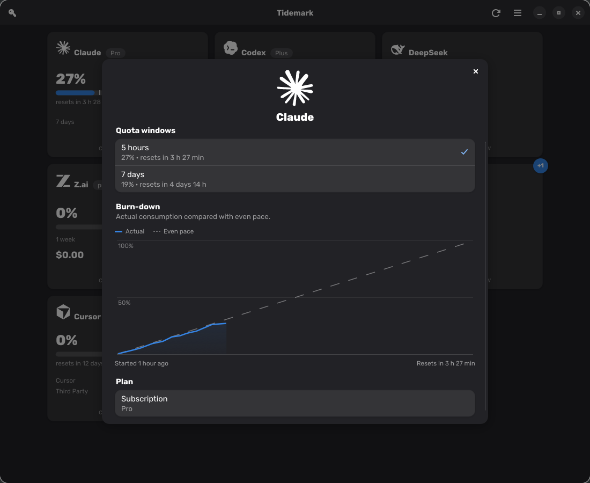
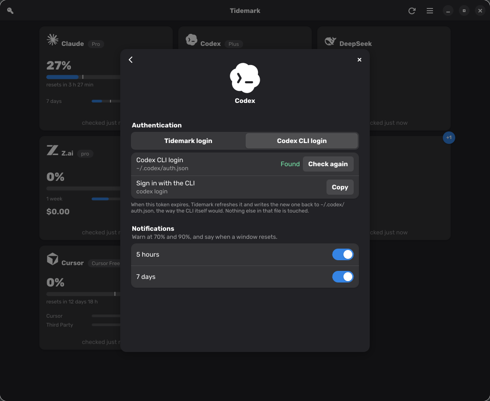
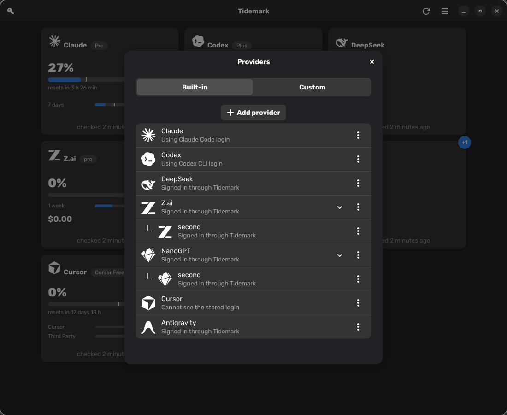
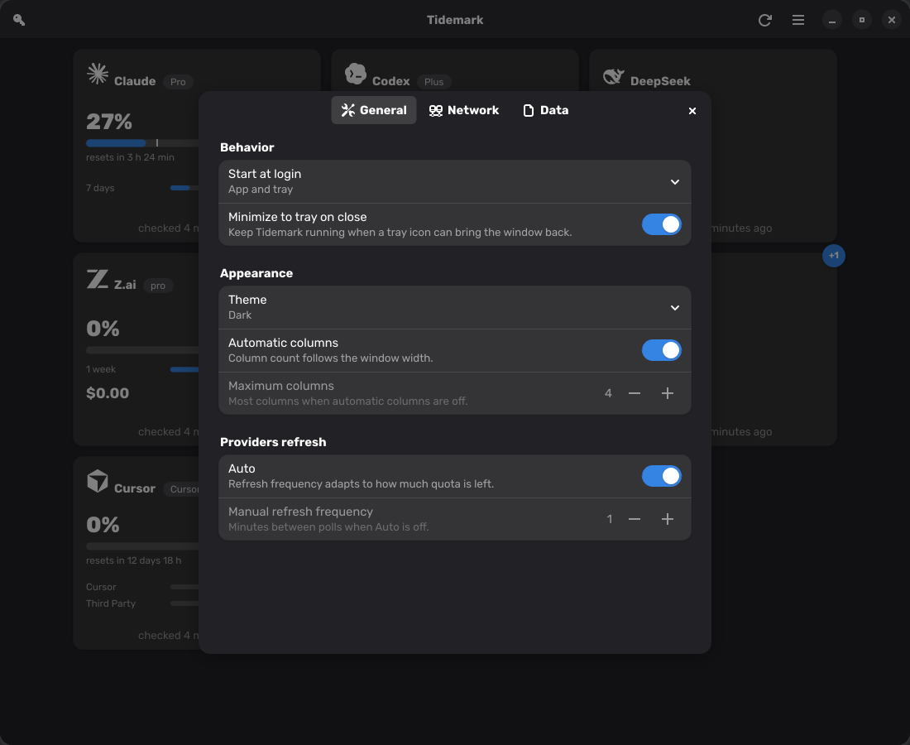

<div align="center">


# Tidemark

**See how much of your AI quota is left**


---



</div>

---

Tidemark is a desktop app for Linux and Windows that tracks the usage limits of your AI
subscriptions and API keys.

- **[58 providers](#supported-providers),** with everything each one reports about your
  usage. A service that is not on the list can be added with a
  [provider plugin](docs/plugin-providers.md).
- **Multi-account.** Add several accounts of the same provider; each gets its own card.
- **Notifications** when a quota is running low and when it resets.
- **History.** A chart of how each window was spent.
- **CLI.** On Linux, [`tidemarkctl`](#from-the-command-line) gives your scripts and panel widgets
  the same readings as the window, as JSON. Waybar output is built in.

---

## Screenshots

| Details | Provider settings |
| --- | --- |
|  |  |

| Providers | Preferences |
| --- | --- |
|  |  |

## Installation

### Ubuntu/Fedora

Download the `.deb` or `.rpm` from the [latest release](https://github.com/zbndev/tidemark/releases/latest).

### Arch Linux

Install from AUR with yay/paru:

```bash
yay -S tidemark-git
```

### Windows

Download the setup executable from the
[latest release](https://github.com/zbndev/tidemark/releases/latest). It installs for the
current user and needs no administrator rights; running a newer one upgrades in place and
keeps your settings and data. The installer is not code-signed, so SmartScreen stops the
first run: More info → Run anyway. Build and recovery instructions are in
[Windows packaging](data/packaging/windows/README.md).

### Nix

Install Tidemark directly from this repository:

```bash
nix profile install github:zbndev/tidemark
```

Or run the window without installing it:

```bash
nix run github:zbndev/tidemark
```

For NixOS, add Tidemark as a flake input, import its module, and enable the service:

```nix
{
  inputs = {
    nixpkgs.url = "github:NixOS/nixpkgs/nixos-unstable";
    tidemark.url = "github:zbndev/tidemark";
  };

  outputs = { nixpkgs, tidemark, ... }: {
    nixosConfigurations.my-host = nixpkgs.lib.nixosSystem {
      system = "x86_64-linux";
      modules = [
        tidemark.nixosModules.default
        { services.tidemark.enable = true; }
      ];
    };
  };
}
```

The module installs Tidemark and registers its D-Bus-activated user daemon. It does not
start the window at login. `nix run github:zbndev/tidemark#tidemarkd` is available for
diagnostics, but normal use should let D-Bus activate the daemon when the window or another
client asks for it.

## Getting started

Open Tidemark. With nothing configured yet it says *Add a provider to start tracking your
quota*.

1. Press **Add provider**.
2. Pick your provider from the searchable list.
3. Sign in, or paste an API key — the detail page says where to find it.

Claude, Codex and Antigravity can sign in through Tidemark, or reuse the login their own CLI
already has.

Removing a provider deletes its Tidemark-owned credentials and its card but keeps the quota
history. A vendor CLI's own credential file remains owned by that CLI and is never removed.

## Privacy

Tidemark connects only to the providers you add, plus GitHub once an hour to check for a new
release; **Preferences → Check for updates** turns that off. There is no telemetry. Keys,
sign-in tokens and pasted sessions are kept in the system keyring (Secret Service on Linux,
Credential Manager on Windows), never in a config file.

## From the command line

On Linux, `tidemarkctl` talks to the same daemon the window does, so anything the interface
can do is scriptable — and a panel widget needs no D-Bus code of its own.

```bash
tidemarkctl usage                      # every account, for a person
tidemarkctl usage --format json        # {"accounts": [...]}, for a program
tidemarkctl guard --min-remaining 20 --window w604800 || echo "not this week"
tidemarkctl watch                      # one JSON object per change, until you stop it
```

`guard` exits `0` when the quota is there, `1` when it is not, and `69` when there is no
trustworthy reading to judge — a rejected credential never answers "safe".

Secrets are read from stdin, never from the command line:

```bash
printf '%s' "$ZAI_API_KEY" | tidemarkctl auth set-key zai
```

Commands that act on one existing account use `default` unless `--account work` says
otherwise. Aggregate commands keep their broader meaning: `usage`, `guard` and `watch`
still include every matching account when no account filter is given.

A newly added Claude, Codex or Antigravity account starts pinned to Tidemark OAuth; adding
it never silently adopts the vendor CLI's login:

```bash
tidemarkctl provider add codex
tidemarkctl auth login codex

# Or explicitly use the Codex CLI login that already exists:
tidemarkctl auth select codex --mode cli
```

A Waybar module is two files. In `~/.config/waybar/config.jsonc`:

```jsonc
"custom/tidemark": {
    "exec": "tidemarkctl watch --format waybar",
    "return-type": "json",
    "on-click": "tidemark"
}
```

and in your stylesheet, the classes it sets — `ok`, `warning`, `danger` at the same 70% and
90% the app's own bar changes colour at, plus `stale` when the reading is not fresh:

```css
#custom-tidemark.warning { color: @warning_color; }
#custom-tidemark.danger  { color: @error_color; }
#custom-tidemark.stale   { opacity: 0.5; }
```

`tidemarkctl completions zsh > ~/.zfunc/_tidemarkctl` installs completions;
`tidemarkctl --help` lists the rest.

## Reporting a wrong reading

If a card shows a number the provider's own dashboard disagrees with, the useful evidence
is the response Tidemark actually received. Put this in `config.toml`
(`~/.config/tidemark/` on Linux, `%LOCALAPPDATA%\tidemark\` on Windows):

```toml
[debug]
raw_responses = true
```

then restart the daemon: `systemctl --user restart tidemarkd` on Linux; on Windows, choose
**Quit** in the tray menu and open Tidemark again (with **Daemon only** startup, end
`tidemarkd.exe` in Task Manager first). Every provider response is written verbatim, one JSON
object per line, to `~/.local/share/tidemark/debug/responses.ndjson` on Linux or
`%LOCALAPPDATA%\tidemark\debug\responses.ndjson` on Windows:

```bash
jq 'select(.provider == "opencodego")' ~/.local/share/tidemark/debug/responses.ndjson
```

API keys are never written: request headers are left out entirely, URL query strings are
redacted, and the sign-in endpoints are not logged at all. The file still describes your
account's usage, so read it before attaching it to an issue. It rolls over at 16 MB and
keeps one previous file. There is no switch in the interface — turning it off is the same
edit, and a restart.

## Supported providers

**Sign in with your account**

Antigravity · Claude · Codex

**Paste an API key**

ai& · Amp · Chutes · ClawRouter · ClinePass · Codebuff · Crof · Deepgram · DeepInfra · DeepSeek ·
ElevenLabs · Factory · Fireworks · Groq · IBM Bob · Kilo · Kimi · LiteLLM · LLM Proxy · MiniMax ·
Moonshot · NanoGPT · Neuralwatt · Ollama · OpenAI · OpenCode Go · OpenRouter · Poe · StepFun ·
sub2api · Synthetic · Venice · Warp · xAI · Z.ai · ZenMux

**Use your browser or app login**

Abacus · Alibaba Coding Plan · Augment · CommandCode · Cursor · Gemini · Grok · LongCat · Manus · MiMo · Mistral · Notion · Ollama · OpenCode · Perplexity · Qoder · Sakana · T3 Chat · ZoomMate

Cursor's **Cursor App** authentication tab lists **Cursor App** and **Cursor CLI** as
separate sources. Sign in with the chosen application, then select its row. Tidemark reads
the CLI's `$XDG_CONFIG_HOME/cursor/auth.json` (default `~/.config/cursor/auth.json`) on
Linux, or `%APPDATA%\Cursor\auth.json` on Windows, without changing it.

**No credential needed**

Wayfinder

T3 Chat is Linux-only for now.

**Something else**

If the service you use is not listed, you can teach Tidemark to read it without waiting for
a release. A provider plugin is one `.tidemark-provider` file — metadata, a sandboxed Lua
transformation and an optional mark — that you import from **Providers → Custom → Add provider**,
then point at your own endpoint with your own key. The file cannot name a host and
never sees the key. See [`docs/plugin-providers.md`](docs/plugin-providers.md) for the
format, the sandbox and a worked example.

## Requirements

**Linux:** a Wayland or X11 desktop with OpenGL. The packages are built for **Fedora 44+**
and **Ubuntu 26.04 LTS+** and their derivatives; Arch and other rolling releases are fine.

**Windows:** Windows 10 version 1803 or newer, x64.

## Building from source

Needs Rust 1.92 or newer, CMake, Clang, and the development packages for fontconfig and
SQLite:

```bash
git clone https://github.com/zbndev/tidemark.git
```

```bash
cargo build --workspace
```

```bash
cargo run -p tidemark
```

`tidemarkd` does the polling and `tidemark` is the window. The window never talks to a
provider itself — it only shows what the daemon publishes on D-Bus, which also makes the
daemon usable from `busctl` or a Waybar module. See [`CONTEXT.md`](CONTEXT.md) for the
architecture and the design record.

## License

MIT — see [`LICENSE`](LICENSE).

The provider marks under `data/icons` are their owners' trademarks and are not covered by
this licence; see [`docs/TRADEMARKS.md`](docs/TRADEMARKS.md), which also explains how to
build without them.

Provider protocol details are taken from [CodexBar](https://github.com/steipete/CodexBar)
(MIT).
